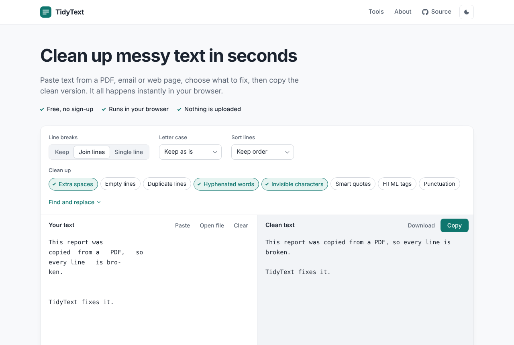
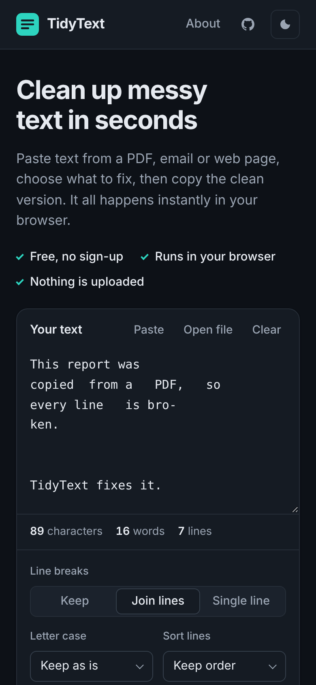

<div align="center">


# TidyText

**Clean up messy text in seconds.** Fix line breaks from PDFs, extra spaces, invisible characters and letter case, instantly and privately in your browser.

[](https://github.com/Shahryartariq/django-text-formatter/actions/workflows/ci.yml)


[](LICENSE)

</div>

<p align="center">
  
  &nbsp;
  
</p>

## What it does

Paste text copied from a PDF, email or web page. Pick what to fix. Copy the clean version.

| Problem | Fix |
| --- | --- |
| Text from a PDF breaks at the end of every line | **Join lines, keep paragraphs** |
| PDF splits words across lines ("infor- mation") | **Fix hyphenated words** |
| Everything should be on one line | **Remove all line breaks** |
| Double spaces, tabs, spaces at line ends | **Remove extra spaces** |
| Blank lines everywhere | **Remove empty lines** |
| A list full of repeats | **Remove duplicate lines** |
| A list in random order | **Sort lines** A to Z or Z to A (ignores case and accents) |
| Curly quotes and long dashes break code or CSV | **Straight quotes** |
| Copied HTML instead of text | **Remove HTML tags** (decodes entities, keeps line breaks) |
| Zero-width spaces and soft hyphens breaking code or passwords | **Remove invisible characters** |
| Commas, quotes, dashes in the way | **Remove punctuation** (any language) |
| A word needs changing everywhere | **Find and replace** (supports `\n` for new lines) |
| Caps lock was on | **Sentence case, lowercase, UPPERCASE, Title Case** |
| How long is this? | **Word counter**: words, characters, sentences, paragraphs, reading and speaking time |

You can paste with one click, open a text file or drag it onto the page. Files are read on your device and never uploaded.

The result updates as you type, and a highlighted counter shows exactly how many characters, words and lines changed.

Each fix also has its own page (16 in total), such as `/fix-pdf-line-breaks/`, `/word-counter/` and `/remove-duplicate-lines/`, so people searching for that exact problem land on a page that solves it.

## Why it's built this way

- **Private.** Text is cleaned in the browser by `static/js/transforms.js`. Nothing is uploaded. No cookies, accounts or ads, and no analytics unless you turn them on.
- **Works without JavaScript.** The same form posts to Django, which runs the identical Python implementation (`tools/transforms.py`). Both are tested against one shared set of cases, so they always agree.
- **Fast.** No frameworks, no web fonts, no third-party requests. The home page is about 4 KB gzipped. Pages set no cookies, so the CDN caches them.
- **Secure.** Strict Content-Security-Policy with no inline scripts, HSTS, clickjacking protection, Permissions-Policy, input size limits, no database and no admin panel. See [SECURITY.md](SECURITY.md).
- **Accessible.** Keyboard friendly, visible focus, labelled controls, screen-reader announcements, dark mode and reduced motion support.
- **Search friendly.** Unique titles and descriptions per tool, canonical URLs, `sitemap.xml`, `robots.txt`, Open Graph cards and JSON-LD (WebApplication, FAQPage, BreadcrumbList).

## Tech stack

| Layer | Technology |
| --- | --- |
| Backend | Python 3.12+, Django 6.1 (stateless: no database, sessions or cookies) |
| Frontend | Django templates, plain CSS, vanilla JavaScript modules |
| Static files | WhiteNoise (gzip, long-term caching) |
| Server | Gunicorn |
| Container | Docker (multi-stage, non-root, read-only filesystem) |
| Hosting | Vercel (serverless Python + CDN) or any Docker host |
| Quality | Django test runner, Node test runner, Ruff, GitHub Actions |

## Quick start

You need Python 3.12+, Node 20+ (only for the JavaScript tests) and `make`. On Windows, `make` works from PowerShell, cmd or Git Bash as long as [Git for Windows](https://git-scm.com/download/win) is installed (the recipes run in its bash). WSL or Docker work too.

```bash
git clone https://github.com/Shahryartariq/django-text-formatter.git tidytext
cd tidytext
make install   # virtualenv + dependencies
make dev       # http://localhost:8000
```

## Make shortcuts

Run `make` to see them all.

| Command | What it does |
| --- | --- |
| `make install` | Create `.venv` and install dependencies |
| `make env` | Create `.env` with a fresh secret key |
| `make dev` | Development server with auto-reload |
| `make serve` | Run like production locally (Gunicorn) |
| `make test` | Python and JavaScript tests |
| `make lint` / `make format` | Check / fix code style with Ruff |
| `make check` | Django's production deployment checks |
| `make ci` | Everything CI runs |
| `make docker-build` | Build the production image |
| `make docker-run` | Build and run the image on port 8000 |
| `make up` / `make down` / `make logs` | Docker Compose |
| `make secret` | Print a new `DJANGO_SECRET_KEY` |
| `make cases` | Regenerate shared test cases |
| `make assets` | Redraw icons and the social card |
| `make release VERSION=x.y.z` | Run CI checks, then tag and push a release |

## Deploy to Vercel

1. Import the repository in Vercel (**Add New → Project**). No build settings are needed; `vercel.json` configures everything.
2. Under **Settings → Environment Variables**, add:
   - `DJANGO_SECRET_KEY`: a long random value (run `make secret`). **Required.**
   - `SITE_URL`: your public address, for example `https://tidytext.vercel.app` (recommended, used for canonical links and the sitemap).
   - `DJANGO_ALLOWED_HOSTS`: only if you add a custom domain, for example `tidytext.com,www.tidytext.com`. Vercel's own domains are allowed automatically.
   - `GA_MEASUREMENT_ID`: optional, your Google Analytics 4 ID (see below).
3. Deploy. Static files are served from Vercel's CDN, and pages are cached at the edge until the next deploy.

## Google Analytics

Don't paste Google's tag snippet into a template: the Content-Security-Policy blocks inline scripts, so it wouldn't run. Instead, set `GA_MEASUREMENT_ID` (for example `G-ABC123XYZ9`) and redeploy. TidyText then:

- loads `gtag.js` and a small static `analytics.js`, so no inline script is needed;
- adds only Google's analytics domains to the security policy;
- switches the privacy page, About page and footer to say that Google Analytics is used.

Only page views are sent. The text people clean is never sent to Google. If you have visitors in the EU or UK, check whether you need a cookie consent banner.

## Run with Docker

```bash
make env     # creates .env with a secret key
make up      # http://localhost:8000
```

Or without Compose:

```bash
docker build -t tidytext .
docker run --rm -p 8000:8000 -e DJANGO_SECRET_KEY=change-me tidytext
```

Every tagged release also publishes an image to GitHub Container Registry:

```bash
docker run --rm -p 8000:8000 -e DJANGO_SECRET_KEY=change-me ghcr.io/shahryartariq/tidytext:latest
```

## Configuration

All settings come from environment variables. See [`.env.example`](.env.example).

| Variable | Default | Purpose |
| --- | --- | --- |
| `DJANGO_SECRET_KEY` | (none) | Required in production |
| `DJANGO_DEBUG` | `0` | `1` for local development only |
| `DJANGO_ALLOWED_HOSTS` | `localhost,127.0.0.1` | Extra host names; Vercel URLs are added automatically |
| `SITE_URL` | request host | Public base URL for canonical links, sitemap and social cards |
| `DJANGO_SECURE_SSL_REDIRECT` | `0` | Redirect HTTP to HTTPS (Vercel already does this) |
| `DJANGO_HSTS_SECONDS` | `31536000` | HSTS max age in production |
| `GA_MEASUREMENT_ID` | (none) | Optional Google Analytics 4 ID, e.g. `G-ABC123XYZ9` |
| `WEB_CONCURRENCY` | CPU based, max 4 | Gunicorn workers (Docker) |

## Project structure

```
├── api/index.py            # Vercel entry point
├── tidytext/               # Django project: settings, URLs, WSGI/ASGI
├── tools/
│   ├── transforms.py       # The text transformations (pure Python)
│   ├── catalog.py          # Tools, their presets and page copy
│   ├── views.py            # Pages, form fallback, robots.txt, health check
│   ├── middleware.py       # Security and cache headers
│   ├── sitemaps.py
│   └── tests/              # Python tests + cases.json shared with JS
├── templates/              # Base layout, tool page, about, privacy, errors
├── static/
│   ├── css/app.css
│   ├── js/transforms.js    # Browser port of transforms.py
│   ├── js/app.js           # Live updates, copy, download
│   └── img/                # Icons and social card
├── tests/js/               # JavaScript tests (node --test)
├── scripts/                # Test-case and asset generators
├── Dockerfile, docker-compose.yml, gunicorn.conf.py
├── vercel.json
└── Makefile
```

## Adding a tool

1. Add a `Tool(...)` entry to `tools/catalog.py` with a slug, page copy and preset options.
2. If it needs a new transformation, add it to both `tools/transforms.py` and `static/js/transforms.js`, add inputs to `scripts/case_inputs.json`, then run `make cases` and `make test`.

The page, sitemap entry, footer link and structured data are created automatically.

## License

[MIT](LICENSE) © Muhammad Shehryar
